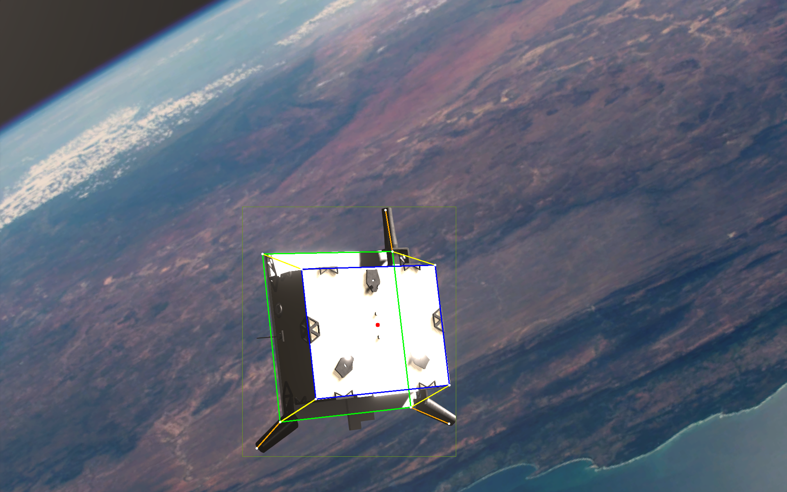

# YOLO-SPN: Fast Spacecraft Pose Estimation

This repository was created by Alden Doyle at Microchip Technology. This was forked from the MIT-licensed [YOLOv9](https://github.com/MultimediaTechLab/YOLO) repository and adds the features for spacecraft pose esimtation as done in [SPNv2](https://github.com/tpark94/spnv2). The motivation is to perform spacecraft pose estimation with a more efficient model architecture.



## Installation

To get started, we recommand you clone this repository and install the required dependencies:

```shell
git clone git@github.com:Microchip-Vectorblox/YOLO-SPN.git
cd YOLO-SPN
pip install -r requirements.txt
```

## Tasks

This was tested with a synthetic dataset created by SPIN and also with the Speed+ dataset. 

### Training

To train YOLO-SPN on your machine/dataset:

1. Modify the configuration file `yolo/config/dataset/**.yaml` to point to your dataset.
2. Run the training script:

```shell

python yolo/lazy.py task=train
    weight=weights/v9-s.pt \ # start with COCO-trained weights
    model=v9-s-sp \          # select "t", "s", or "m" size
    use_wandb=False \
    dataset='spinrgb' \      # dataset config
    use_tensorboard=True \
    image_size=[768,512] \   # default input shape
    name=v9-s-sp
```

### Validation

To validate model performance.

```shell
python yolo/lazy.py task=validation \
    weight='runs/train/v9-s-sp/lightning_logs/version_1/checkpoints/final.ckpt' \ # model checkpoint
    model=v9-s-sp \
    use_wandb=False \
    dataset='spinrgb' \
    image_size=[768,512] \
    name=v9-s-sp
```

### Export

To export a saved checkpoint to an onnx file:

```shell
python yolo/lazy.py task=export \
    weight='runs/train/v9-s-sp/lightning_logs/version_1/checkpoints/final.ckpt' \ # model checkpoint
    model=v9-s-sp \
    use_wandb=False \
    dataset='spinrgb' \
    image_size=[768,512] \
    name=yolov9s-spn_spin1_768x512 # .onnx file name
```

## Training Results on SPIN

|      |       |validation|       |
| :--- | :---: |  :---:   | :---: |
|      |E_T [m]| E_R [deg]| E_pose|
| v9t  | 0.0462| 1.5541   | 0.0353|
| v9s  | 0.0315| 0.9817   | 0.0228|
| v9m  | 0.0205| 0.6840   | 0.0156|

## Training Results on SPEED+

|      |       |validation|      |       |lightbox |       |       | sunlamp |       |
| :--- | :---: |  :---:  | :---: | :---: |  :---:  | :---: | :---: |  :---:  | :---: |
|      |E_T [m]|E_R [deg]|E_pose |E_T [m]|E_R [deg]|E_pose |E_T [m]|E_R [deg]|E_pose |
| v9t  | 0.0913| 3.0019  | 0.0683| 0.5193| 29.8049 | 0.6086| 0.4076| 29.2459 | 0.5728|
| v9s  | 0.0596| 1.8506  | 0.0427| 0.4112| 21.4174 | 0.4431| 0.3441| 22.0753 | 0.4381|
| v9m  | 0.0338| 1.0219  | 0.0236| 0.2721| 13.6424 | 0.2837| 0.2396| 14.3342 | 0.2895|

The lightbox and sunlamp datasets are quite different from the training and validation set. To improve performance, more image augmentations were enabled as done in SPNv2. These were trained with style, coarse dropout, and random sun flare. These results could likely be further improved with hyperparameter optimization.

Example training script:
```shell
python yolo/lazy.py task=train weight=weights/v9-s.pt model=v9-s-sp use_wandb=False dataset='speedplus' use_tensorboard=True image_size=[768,512] name=v9-s-sp task.data.batch_size=32 task.data.equivalent_batch_size=32 task.data.style=0.5 task.data.data_augment.CoarseDropout=0.5 task.data.data_augment.RandomSunFlare=0.5
```
## References
### Papers

- [**YOLOv9**: Learning What You Want to Learn Using Programmable Gradient Information](https://arxiv.org/abs/2402.13616)
- [**SPNv2**: Robust Multi-Task Learning and Online Refinement for Spacecraft Pose Estimation across Domain Gap](https://arxiv.org/abs/2203.04275)
- [**SPIN**: Spacecraft Imagery for Navigation](https://arxiv.org/abs/2406.07500)

### Repositories
- [**YOLO**: Official Implementation of YOLOv9, YOLOv7, YOLO-RD](https://github.com/MultimediaTechLab/YOLO)
- [**SPNv2**: Robust Multi-task Learning and Online Refinement for Spacecraft Pose Estimation across Domain Gap](https://github.com/tpark94/spnv2)
- [**SPIN**: An Open Simulator of Realistic Spacecraft Navigation Imagery](https://github.com/vpulab/SPIN)
